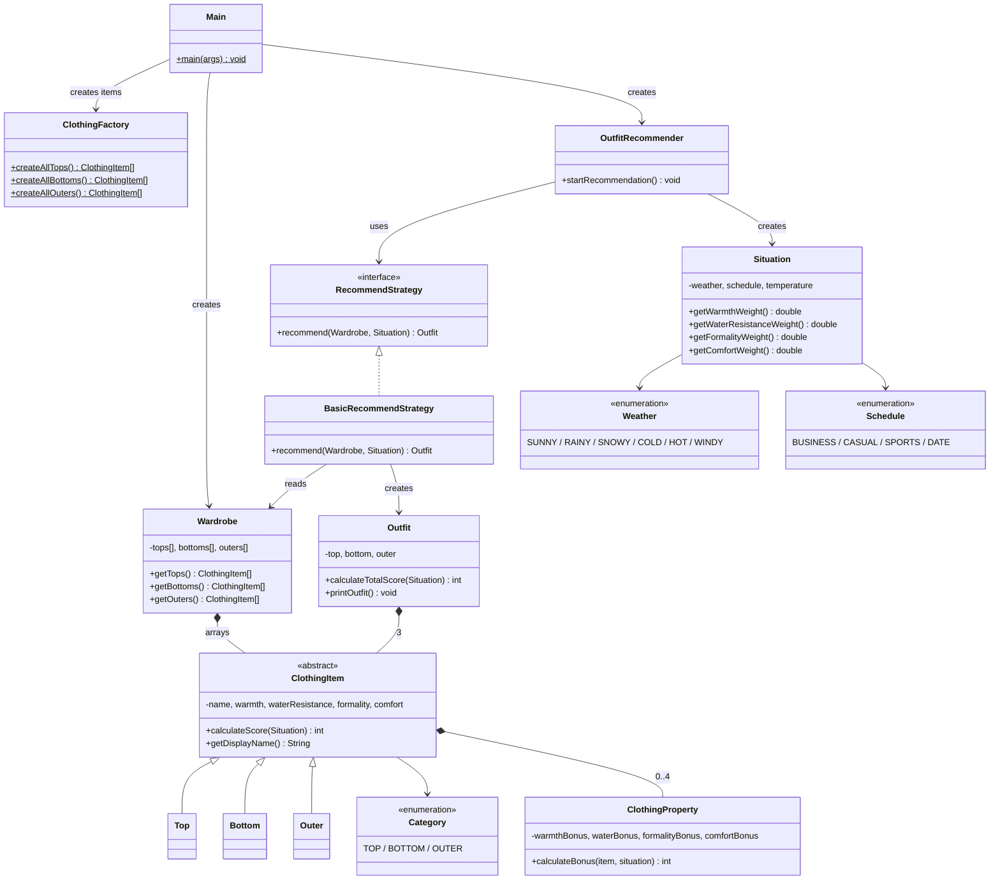
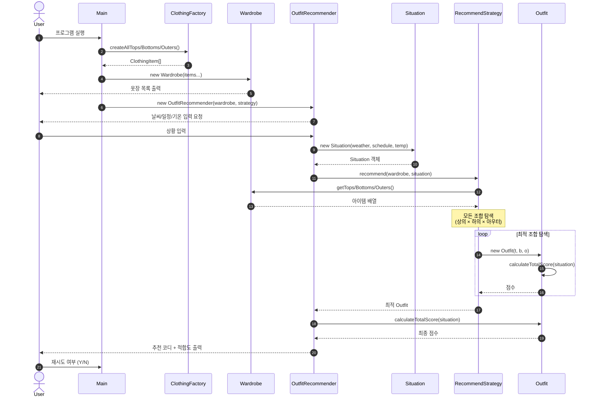

# 코디네이터 - 클래스 다이어그램 & 순차도 (간소화)

## 1. 클래스 다이어그램

## 2. 순차도

## 3. 핵심 요약

| 구성요소 | 역할 |
|---------|------|
| **ClothingItem** | 옷의 기본 능력치 (보온/방수/격식/편안) |
| **Situation** | 오늘 상황 (날씨+일정+기온) → 가중치 계산 |
| **Outfit** | 상의+하의+아우터 조합 → 총점 계산 |
| **RecommendStrategy** | 추천 알고리즘 인터페이스 |
| **BasicRecommendStrategy** | 모든 조합을 탐색해 최고 점수 코디 선택 |
| **OutfitRecommender** | 사용자 입력 받고 추천 결과 출력 |
| **ClothingFactory** | 팩토리 패턴으로 옷 아이템 생성 |

---

*상세 버전은 `classDiagram_detailed.md`를 참조하세요.*
