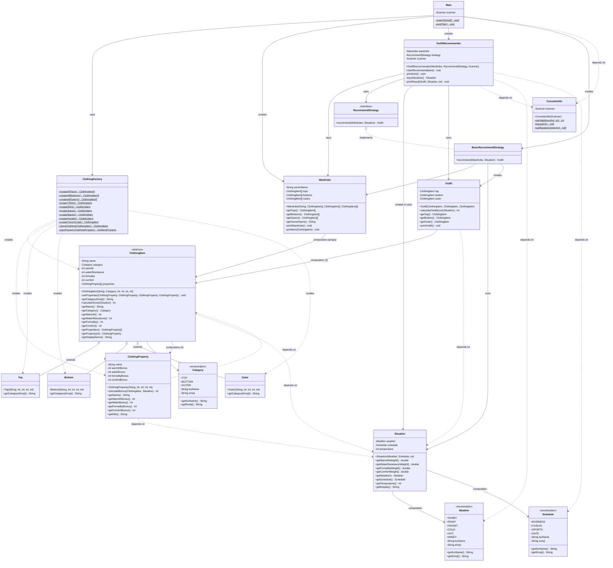
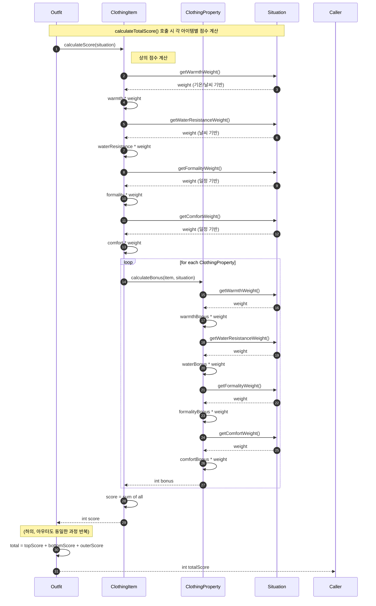

# 날씨 및 목적 기반 외출 코디네이터 - 클래스 다이어그램 및 순차도

## 1. 클래스 다이어그램 (Class Diagram)

---

## 2. 순차도 (Sequence Diagram)

### 2.1 전체 프로그램 실행 흐름

```mermaid
sequenceDiagram
    autonumber
    actor User
    participant Main
    participant ConsoleUtils
    participant ClothingFactory
    participant Wardrobe
    participant OutfitRecommender
    participant Situation
    participant RecommendStrategy
    participant BasicRecommendStrategy
    participant Outfit
    participant ClothingItem
    participant Weather
    participant Schedule

    %% ========== Initialization ==========
    User->>Main: java Main
    Main->>ConsoleUtils: new ConsoleUtils(scanner)
    ConsoleUtils-->>Main: ConsoleUtils instance
    Main->>Main: printTitle()

    %% ========== Main Loop ==========
    loop repeat until user exits
        %% ========== Create Wardrobe ==========
        Main->>ClothingFactory: createAllTops()
        ClothingFactory->>ClothingFactory: createTShirt()
        ClothingFactory->>Top: new Top("반팔티", 20, 10, 10, 80)
        Top-->>ClothingFactory: Top instance
        ClothingFactory->>ClothingFactory: createShirt()
        ClothingFactory->>Top: new Top("셔츠", 30, 20, 70, 50)
        Top-->>ClothingFactory: Top instance
        ClothingFactory-->>Main: ClothingItem[2] (tops)

        Main->>ClothingFactory: createAllBottoms()
        ClothingFactory->>ClothingFactory: createJeans()
        ClothingFactory->>Bottom: new Bottom("청바지", 40, 30, 40, 70)
        Bottom-->>ClothingFactory: Bottom instance
        ClothingFactory->>ClothingFactory: createSlacks()
        ClothingFactory->>Bottom: new Bottom("슬랙스", 35, 25, 80, 50)
        Bottom-->>ClothingFactory: Bottom instance
        ClothingFactory-->>Main: ClothingItem[2] (bottoms)

        Main->>ClothingFactory: createAllOuters()
        ClothingFactory->>ClothingFactory: createHoodie()
        ClothingFactory->>Outer: new Outer("후드집업", 60, 30, 20, 80)
        Outer-->>ClothingFactory: Outer instance
        ClothingFactory->>ClothingFactory: createTrenchCoat()
        ClothingFactory->>Outer: new Outer("트렌치코트", 50, 60, 80, 40)
        Outer-->>ClothingFactory: Outer instance
        ClothingFactory-->>Main: ClothingItem[2] (outers)

        Main->>Wardrobe: new Wardrobe("사용자", tops, bottoms, outers)
        Wardrobe-->>Main: Wardrobe instance

        Main->>Wardrobe: printWardrobe()
        Wardrobe-->>User: 옷장 목록 출력

        %% ========== Create Recommender ==========
        Main->>BasicRecommendStrategy: new BasicRecommendStrategy()
        BasicRecommendStrategy-->>Main: BasicRecommendStrategy instance
        Main->>OutfitRecommender: new OutfitRecommender(wardrobe, strategy, scanner)
        OutfitRecommender-->>Main: OutfitRecommender instance

        %% ========== Start Recommendation ==========
        Main->>OutfitRecommender: startRecommendation()

        %% --- Step 1: Print Intro ---
        OutfitRecommender->>OutfitRecommender: printIntro()
        OutfitRecommender-->>User: "코디 추천 시뮬레이터" 타이틀 출력

        %% --- Step 2: Input Weather ---
        OutfitRecommender->>OutfitRecommender: inputSituation()
        OutfitRecommender->>Weather: Weather.values()
        Weather-->>OutfitRecommender: Weather[]
        OutfitRecommender-->>User: 날씨 선택 목록 출력
        User->>OutfitRecommender: 날씨 번호 입력
        OutfitRecommender->>ConsoleUtils: getValidInput(1, 6)
        ConsoleUtils-->>OutfitRecommender: valid choice (int)

        %% --- Step 3: Input Schedule ---
        OutfitRecommender->>Schedule: Schedule.values()
        Schedule-->>OutfitRecommender: Schedule[]
        OutfitRecommender-->>User: 일정 선택 목록 출력
        User->>OutfitRecommender: 일정 번호 입력
        OutfitRecommender->>ConsoleUtils: getValidInput(1, 4)
        ConsoleUtils-->>OutfitRecommender: valid choice (int)

        %% --- Step 4: Input Temperature ---
        OutfitRecommender-->>User: 기온 입력 요청
        User->>OutfitRecommender: 기온 입력
        OutfitRecommender->>ConsoleUtils: getValidInput(-10, 40)
        ConsoleUtils-->>OutfitRecommender: valid temperature (int)

        %% --- Step 5: Create Situation ---
        OutfitRecommender->>Situation: new Situation(weather, schedule, temp)
        Situation-->>OutfitRecommender: Situation instance

        %% --- Step 6: Pause for effect ---
        OutfitRecommender->>ConsoleUtils: pause(1000)
        ConsoleUtils-->>OutfitRecommender: (1초 대기)

        %% ========== Recommendation Logic ==========
        OutfitRecommender->>RecommendStrategy: recommend(wardrobe, situation)
        RecommendStrategy->>BasicRecommendStrategy: recommend(wardrobe, situation)

        BasicRecommendStrategy->>Wardrobe: getTops()
        Wardrobe-->>BasicRecommendStrategy: ClothingItem[] tops
        BasicRecommendStrategy->>Wardrobe: getBottoms()
        Wardrobe-->>BasicRecommendStrategy: ClothingItem[] bottoms
        BasicRecommendStrategy->>Wardrobe: getOuters()
        Wardrobe-->>BasicRecommendStrategy: ClothingItem[] outers

        %% --- Brute-force search all combinations ---
        BasicRecommendStrategy->>BasicRecommendStrategy: bestScore = -1, bestOutfit = null
        loop for each top in tops
            loop for each bottom in bottoms
                loop for each outer in outers
                    BasicRecommendStrategy->>Outfit: new Outfit(top, bottom, outer)
                    Outfit-->>BasicRecommendStrategy: Outfit instance

                    BasicRecommendStrategy->>Outfit: calculateTotalScore(situation)
                    Outfit->>ClothingItem: calculateScore(situation)
                    ClothingItem->>Situation: getWarmthWeight()
                    Situation-->>ClothingItem: double
                    ClothingItem->>Situation: getWaterResistanceWeight()
                    Situation-->>ClothingItem: double
                    ClothingItem->>Situation: getFormalityWeight()
                    Situation-->>ClothingItem: double
                    ClothingItem->>Situation: getComfortWeight()
                    Situation-->>ClothingItem: double
                    ClothingItem->>ClothingProperty: calculateBonus(item, situation)
                    ClothingProperty->>Situation: getWarmthWeight()
                    Situation-->>ClothingProperty: double
                    ClothingProperty->>Situation: getWaterResistanceWeight()
                    Situation-->>ClothingProperty: double
                    ClothingProperty->>Situation: getFormalityWeight()
                    Situation-->>ClothingProperty: double
                    ClothingProperty->>Situation: getComfortWeight()
                    Situation-->>ClothingProperty: double
                    ClothingProperty-->>ClothingItem: int bonus
                    ClothingItem-->>Outfit: int score

                    Outfit->>ClothingItem: calculateScore(situation)
                    ClothingItem-->>Outfit: int score

                    Outfit->>ClothingItem: calculateScore(situation)
                    ClothingItem-->>Outfit: int score

                    Outfit-->>BasicRecommendStrategy: int totalScore

                    alt if totalScore > bestScore
                        BasicRecommendStrategy->>BasicRecommendStrategy: bestScore = totalScore
                        BasicRecommendStrategy->>BasicRecommendStrategy: bestOutfit = current
                    end
                end
            end
        end

        BasicRecommendStrategy-->>RecommendStrategy: Outfit (best)
        RecommendStrategy-->>OutfitRecommender: Outfit (best)

        %% ========== Calculate Final Score ==========
        OutfitRecommender->>Outfit: calculateTotalScore(situation)
        Outfit-->>OutfitRecommender: int score

        %% ========== Print Result ==========
        OutfitRecommender->>OutfitRecommender: printResult(outfit, situation, score)
        OutfitRecommender->>Situation: getDisplay()
        Situation-->>OutfitRecommender: String display
        OutfitRecommender-->>User: 오늘의 상황 출력

        OutfitRecommender->>Outfit: printOutfit()
        Outfit->>ClothingItem: getDisplayName()
        ClothingItem-->>Outfit: String
        Outfit-->>User: 추천 코디 출력

        OutfitRecommender-->>User: 적합도 점수 및 평가 출력

        %% ========== Repeat Prompt ==========
        Main-->>User: "다시 추천받으시겠습니까? (Y/N)"
        User->>Main: Y 또는 N 입력
    end

    Main-->>User: "안녕히 가세요"
```

### 2.2 점수 계산 상세 흐름

---

## 3. 다이어그램 설명

### 클래스 다이어그램 주요 관계

| 관계 | 설명 |
|------|------|
| **상속** (--\|>) | `ClothingItem`을 `Top`, `Bottom`, `Outer`가 상속 |
| **구현** (..\|>) | `RecommendStrategy`를 `BasicRecommendStrategy`가 구현 |
| **구성** (--*) | `Outfit`은 `ClothingItem` 3개로 구성됨 (상의, 하의, 아우터) |
| **연관** (-->) | `Situation`은 `Weather`와 `Schedule`을 참조 |
| **의존** (..>) | `ClothingItem.calculateScore()`는 `Situation`에 의존 |

### 순차도 주요 흐름

1. **초기화**: 프로그램 실행 → 유틸리티 초기화 → 옷장 생성
2. **입력**: 사용자가 날씨/일정/기온을 입력 → `Situation` 객체 생성
3. **추천**: `BasicRecommendStrategy`가 모든 코디 조합을 탐색하여 최적의 `Outfit` 선택
4. **점수 계산**: 각 아이템의 능력치 × 상황 가중치 + 특성 별볼너스 = 총 적합도
5. **결과 출력**: 추천 코디와 적합도 점수를 사용자에게 표시

---

*본 다이어그램은 프로젝트의 전체 구조와 실행 흐름을 시각화한 것입니다.*
